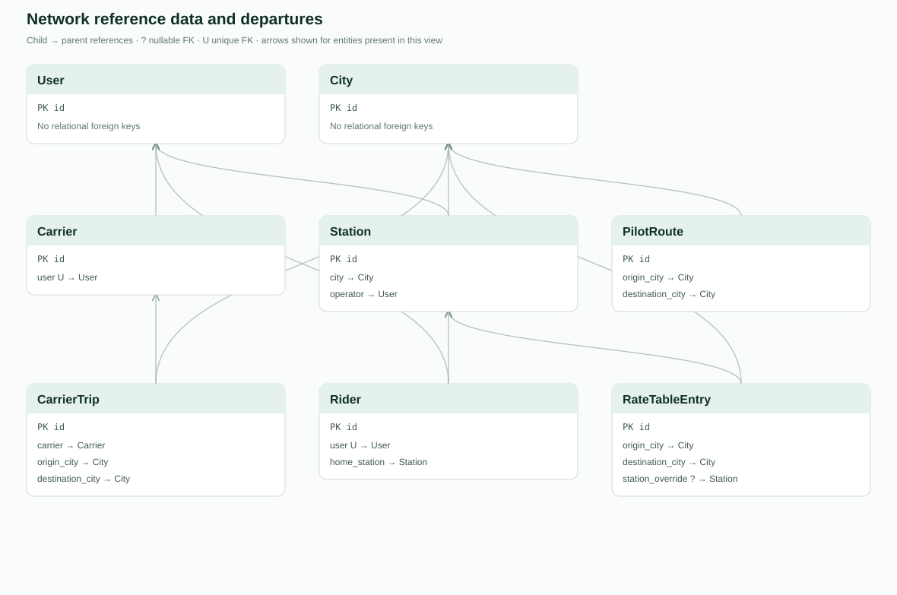
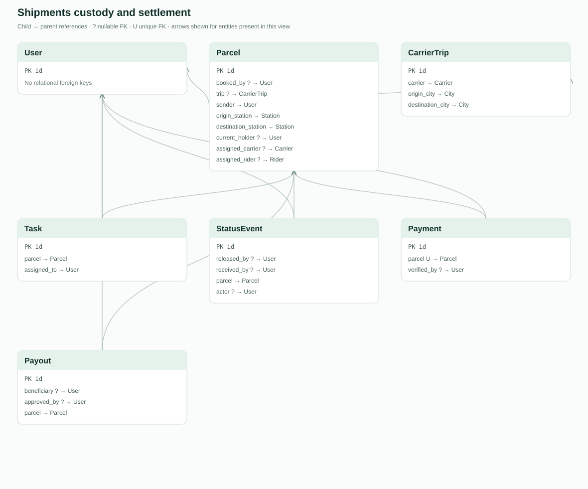
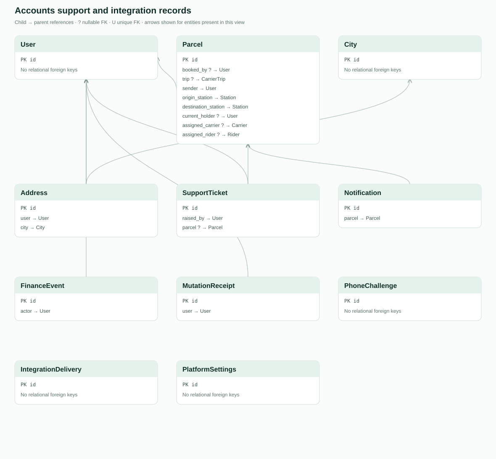

# Pano Logistics Database Document

Version 1.1 · 1 October 2026 · Source-derived logical schema

## Purpose and database boundaries

This document is the data dictionary and entity relationship reference for the current Django application. It covers all 21 marketplace models, Django authentication and framework tables, and the separate custody archive. Field definitions are extracted from Django model metadata by export_schema.py; they are not an invented future schema.

The reviewed local configuration uses SQLite. Setting POSTGRES_DB and the related connection variables selects PostgreSQL. The same Django migrations define the application schema. There are no PostGIS geometry columns in the current implementation, so no GiST spatial indexes exist. Station latitude and longitude are decimal values interpreted as EPSG:4326 coordinates; approximate seed coordinates are not surveyed premises.

The primary relational database holds accounts, catalogs, shipments, tasks and financial records. Uploaded files live in MEDIA_ROOT and database file fields store paths, not file bytes. Authenticated /api/files/ requests enforce document access. The separate SQLite custody archive stores serialized events replicated through the outbox; it has no foreign keys to the primary database.

## Entity relationship diagrams

The following diagrams divide the business schema into readable areas. Shared User and Parcel entities appear in more than one view. See [the complete ER source](er-diagram.mmd) for every reflected table, field, relationship and optional cardinality, including framework tables.







Diagram arrows identify a foreign-key reference from child to parent. Labels state the child field. A 0..1 child-to-parent relationship means the foreign key is nullable; a unique foreign key makes the parent-to-child relationship 0..1 rather than 0..many. The complete Mermaid diagram uses crow's-foot notation.

## Table inventory

| Model | Physical table | Purpose |
| --- | --- | --- |
| User | marketplace_user | Account identity, authentication and the eight operational roles. Inherited Django authentication fields are retained. |
| City | marketplace_city | Town and province reference data used by stations, rates, departures and addresses. |
| Station | marketplace_station | Partner location, operator, contact payment number and optional geographic coordinates. |
| Carrier | marketplace_carrier | One carrier profile per account with approval and vehicle details. |
| Rider | marketplace_rider | One rider profile per account with home station, approval and availability. |
| RateTableEntry | marketplace_ratetableentry | USD tariff for a directed city pair and weight band, optionally overridden at the origin station. |
| Parcel | marketplace_parcel | Canonical shipment, price snapshot, selected receiving method, assignment links and current status/custody projection. |
| Task | marketplace_task | Offered work for a first-mile, inter-town or last-mile leg, including final proof paths. |
| StatusEvent | marketplace_statusevent | Accepted and rejected custody attempts with identities and time. Application-level append-only protection. |
| Payment | marketplace_payment | One externally paid receipt per parcel with review decision and reviewer. |
| Payout | marketplace_payout | An allocation line for rider, carrier, station or platform and its approval/disbursement record. |
| SupportTicket | marketplace_supportticket | Support issue and message history stored as JSON, including external helpdesk reference. |
| Notification | marketplace_notification | Shipment message addressed to a phone and its user read acknowledgement. |
| Address | marketplace_address | Saved customer address, optionally the single default for that account. |
| PlatformSettings | marketplace_platformsettings | Named JSON settings. Values are not a separate typed configuration schema. |
| PilotRoute | marketplace_pilotroute | Active town pairs used to restrict booking, allowing either direction. |
| CarrierTrip | marketplace_carriertrip | Approved carrier departure and capacity against which parcels are assigned. |
| PhoneChallenge | marketplace_phonechallenge | Single-use, hashed phone verification challenge and its attempt counter. |
| IntegrationDelivery | marketplace_integrationdelivery | Durable delivery outbox for SMS, helpdesk requests and archive replication. |
| FinanceEvent | marketplace_financeevent | Application-level append-only audit of payout allocation and settlement actions. |
| MutationReceipt | marketplace_mutationreceipt | Stored successful response and fingerprint for an account-scoped retry key. |

## Reading the data dictionary

PK means primary key; FK means foreign key; UQ means unique; IDX means an indexed field. Django ordinarily indexes foreign keys and unique fields. Nullable refers to a database NULL; blank means form/serializer blank acceptance, which can differ from nullability. A callable default is run when an object is created. Auto created time means auto_now_add. Unlisted defaults mean there is no explicit field default. Business validation in DRF serializers and services can be stricter than these model-level definitions.

Money uses Decimal with two fractional digits. Business primary identifiers use Django auto-increment fields; framework session keys are strings. Stored UTC-aware timestamps are interpreted in Africa/Harare for operational reporting. Date joined and last login belong to Django authentication rather than the parcel journey.

### User

Physical table: marketplace_user. Account identity, authentication and the eight operational roles. Inherited Django authentication fields are retained.

| Column | Logical type | Null | Keys and reference | Default or behavior |
| --- | --- | --- | --- | --- |
| id | BigAuto | No | PK | Blank allowed |
| password | Char (128) | No | — | — |
| last_login | DateTime | Yes | — | Blank allowed |
| is_superuser | Boolean | No | — | Default False |
| username | Char (150) | No | UQ | — |
| first_name | Char (150) | No | — | Blank allowed |
| last_name | Char (150) | No | — | Blank allowed |
| email | Char (254) | No | — | Blank allowed |
| is_staff | Boolean | No | — | Default False |
| is_active | Boolean | No | — | Default True |
| date_joined | DateTime | No | — | Default now |
| role | Char (24) | No | IDX | Default customer |
| phone | Char (24) | No | UQ | — |
| name | Char (160) | No | — | — |
| verified | Boolean | No | — | Default False |

Allowed role: `customer`, `rider`, `carrier`, `station_operator`, `ops`, `finance`, `support`, `admin`.


### City

Physical table: marketplace_city. Town and province reference data used by stations, rates, departures and addresses.

| Column | Logical type | Null | Keys and reference | Default or behavior |
| --- | --- | --- | --- | --- |
| id | BigAuto | No | PK | Blank allowed |
| name | Char (100) | No | — | — |
| province | Char (100) | No | — | — |

Composite uniqueness:

- unique_city_region: (name, province)


### Station

Physical table: marketplace_station. Partner location, operator, contact payment number and optional geographic coordinates.

| Column | Logical type | Null | Keys and reference | Default or behavior |
| --- | --- | --- | --- | --- |
| id | BigAuto | No | PK | Blank allowed |
| name | Char (140) | No | — | — |
| city_id | ForeignKey | No | IDX; FK → marketplace_city.id; PROTECT | — |
| address | Text | No | — | — |
| latitude | Decimal (9, 6) | Yes | — | Blank allowed |
| longitude | Decimal (9, 6) | Yes | — | Blank allowed |
| operator_id | ForeignKey | No | IDX; FK → marketplace_user.id; PROTECT | — |
| active | Boolean | No | IDX | Default True |
| payment_number | Char (32) | No | — | — |

Composite indexes:

- marketplace_city_id_d27add_idx: (city, active)


### Carrier

Physical table: marketplace_carrier. One carrier profile per account with approval and vehicle details.

| Column | Logical type | Null | Keys and reference | Default or behavior |
| --- | --- | --- | --- | --- |
| id | BigAuto | No | PK | Blank allowed |
| review_note | Text | No | — | Blank allowed |
| user_id | OneToOne | No | UQ; IDX; FK → marketplace_user.id; CASCADE | — |
| vehicle_type | Char (80) | No | — | — |
| licence_no | Char (80) | No | UQ | — |
| capacity_kg | Decimal (9, 2) | No | — | — |
| status | Char (12) | No | IDX | Default pending |
| document | File (100) | No | — | Blank allowed |

Allowed status: `pending`, `approved`, `rejected`.


### Rider

Physical table: marketplace_rider. One rider profile per account with home station, approval and availability.

| Column | Logical type | Null | Keys and reference | Default or behavior |
| --- | --- | --- | --- | --- |
| id | BigAuto | No | PK | Blank allowed |
| review_note | Text | No | — | Blank allowed |
| user_id | OneToOne | No | UQ; IDX; FK → marketplace_user.id; CASCADE | — |
| home_station_id | ForeignKey | No | IDX; FK → marketplace_station.id; PROTECT | — |
| status | Char (12) | No | IDX | Default pending |
| available | Boolean | No | — | Default False |
| document | File (100) | No | — | Blank allowed |

Allowed status: `pending`, `approved`, `rejected`.


### RateTableEntry

Physical table: marketplace_ratetableentry. USD tariff for a directed city pair and weight band, optionally overridden at the origin station.

| Column | Logical type | Null | Keys and reference | Default or behavior |
| --- | --- | --- | --- | --- |
| id | BigAuto | No | PK | Blank allowed |
| origin_city_id | ForeignKey | No | IDX; FK → marketplace_city.id; CASCADE | — |
| destination_city_id | ForeignKey | No | IDX; FK → marketplace_city.id; CASCADE | — |
| weight_band | Char (32) | No | — | — |
| price | Decimal (10, 2) | No | — | — |
| station_override_id | ForeignKey | Yes | IDX; FK → marketplace_station.id; CASCADE | Blank allowed |

Composite indexes:

- marketplace_origin__33077e_idx: (origin_city, destination_city, weight_band)

Composite uniqueness:

- unique_rate_rule: (origin_city, destination_city, weight_band, station_override)
- unique_default_rate_rule: (origin_city, destination_city, weight_band); condition (AND: ('station_override__isnull', True))


### Parcel

Physical table: marketplace_parcel. Canonical shipment, price snapshot, selected receiving method, assignment links and current status/custody projection.

| Column | Logical type | Null | Keys and reference | Default or behavior |
| --- | --- | --- | --- | --- |
| id | BigAuto | No | PK | Blank allowed |
| pickup_address | Text | No | — | Blank allowed |
| sender_name | Char (160) | No | — | Blank allowed |
| sender_phone | Char (24) | No | — | Blank allowed |
| booked_by_id | ForeignKey | Yes | IDX; FK → marketplace_user.id; PROTECT | — |
| trip_id | ForeignKey | Yes | IDX; FK → marketplace_carriertrip.id; PROTECT | Blank allowed |
| otp_expires_at | DateTime | Yes | — | Blank allowed |
| otp_target | Char (32) | No | — | Blank allowed |
| otp_attempts | PositiveSmallInteger | No | — | Default 0 |
| notes | Text | No | — | Blank allowed |
| delivery_choice | Char (12) | No | — | Default station |
| delivery_address | Text | No | — | Blank allowed |
| code | Char (6) | No | UQ; IDX | — |
| sender_id | ForeignKey | No | IDX; FK → marketplace_user.id; PROTECT | — |
| recipient_name | Char (160) | No | — | — |
| recipient_phone | Char (24) | No | — | — |
| recipient_access_token | Char (64) | No | UQ | Default token_urlsafe |
| origin_station_id | ForeignKey | No | IDX; FK → marketplace_station.id; PROTECT | — |
| destination_station_id | ForeignKey | No | IDX; FK → marketplace_station.id; PROTECT | — |
| weight_band | Char (32) | No | — | — |
| price | Decimal (10, 2) | No | — | Default 0 |
| photo | File (100) | No | — | Blank allowed |
| status | Char (32) | No | IDX | Default booked |
| current_holder_id | ForeignKey | Yes | IDX; FK → marketplace_user.id; SET_NULL | Blank allowed |
| assigned_carrier_id | ForeignKey | Yes | IDX; FK → marketplace_carrier.id; SET_NULL | Blank allowed |
| assigned_rider_id | ForeignKey | Yes | IDX; FK → marketplace_rider.id; SET_NULL | Blank allowed |
| handover_otp | Char (128) | No | — | — |
| created_at | DateTime | No | IDX | Creation timestamp; Blank allowed |

Allowed delivery_choice: `station`, `home`.

Allowed status: `booked`, `picked_up`, `at_origin_station`, `in_transit`, `at_destination_station`, `out_for_delivery`, `delivered`, `exception`, `returned`, `cancelled`.


### Task

Physical table: marketplace_task. Offered work for a first-mile, inter-town or last-mile leg, including final proof paths.

| Column | Logical type | Null | Keys and reference | Default or behavior |
| --- | --- | --- | --- | --- |
| id | BigAuto | No | PK | Blank allowed |
| parcel_id | ForeignKey | No | IDX; FK → marketplace_parcel.id; CASCADE | — |
| type | Char (30) | No | — | — |
| assigned_to_id | ForeignKey | No | IDX; FK → marketplace_user.id; PROTECT | — |
| status | Char (12) | No | IDX | Default offered |
| proof_photo | File (100) | No | — | Blank allowed |
| signature | File (100) | No | — | Blank allowed |

Allowed type: `first_mile_pickup`, `inter_town_transport`, `last_mile_delivery`.

Allowed status: `offered`, `accepted`, `declined`, `completed`.


### StatusEvent

Physical table: marketplace_statusevent. Accepted and rejected custody attempts with identities and time. Application-level append-only protection.

| Column | Logical type | Null | Keys and reference | Default or behavior |
| --- | --- | --- | --- | --- |
| id | BigAuto | No | PK | Blank allowed |
| released_by_id | ForeignKey | Yes | IDX; FK → marketplace_user.id; PROTECT | Blank allowed |
| received_by_id | ForeignKey | Yes | IDX; FK → marketplace_user.id; PROTECT | Blank allowed |
| recipient_confirmed | Boolean | No | — | Default False |
| parcel_id | ForeignKey | No | IDX; FK → marketplace_parcel.id; PROTECT | — |
| from_status | Char (32) | No | — | — |
| to_status | Char (32) | No | — | — |
| actor_id | ForeignKey | Yes | IDX; FK → marketplace_user.id; PROTECT | — |
| note | Text | No | — | Blank allowed |
| otp_used | Boolean | No | — | Default False |
| accepted | Boolean | No | — | Default True |
| timestamp | DateTime | No | IDX | Creation timestamp; Blank allowed |

Composite indexes:

- marketplace_parcel__e2b8ae_idx: (parcel, timestamp)


### Payment

Physical table: marketplace_payment. One externally paid receipt per parcel with review decision and reviewer.

| Column | Logical type | Null | Keys and reference | Default or behavior |
| --- | --- | --- | --- | --- |
| id | BigAuto | No | PK | Blank allowed |
| transaction_reference | Char (120) | No | — | Blank allowed |
| parcel_id | OneToOne | No | UQ; IDX; FK → marketplace_parcel.id; PROTECT | — |
| amount | Decimal (10, 2) | No | — | — |
| method | Char (40) | No | — | Default mobile_money |
| receipt_photo | File (100) | No | — | Blank allowed |
| status | Char (12) | No | IDX | Default pending |
| verified_by_id | ForeignKey | Yes | IDX; FK → marketplace_user.id; PROTECT | Blank allowed |
| verified_at | DateTime | Yes | — | Blank allowed |

Allowed status: `pending`, `verified`, `rejected`.


### Payout

Physical table: marketplace_payout. An allocation line for rider, carrier, station or platform and its approval/disbursement record.

| Column | Logical type | Null | Keys and reference | Default or behavior |
| --- | --- | --- | --- | --- |
| id | BigAuto | No | PK | Blank allowed |
| beneficiary_id | ForeignKey | Yes | IDX; FK → marketplace_user.id; PROTECT | Blank allowed |
| approved_by_id | ForeignKey | Yes | IDX; FK → marketplace_user.id; PROTECT | Blank allowed |
| approved_at | DateTime | Yes | — | Blank allowed |
| disbursed_at | DateTime | Yes | — | Blank allowed |
| payment_reference | Char (120) | No | — | Blank allowed |
| parcel_id | ForeignKey | No | IDX; FK → marketplace_parcel.id; PROTECT | — |
| leg | Char (16) | No | — | Blank legacy/route; first_mile or last_mile |
| recipient | Char (12) | No | IDX | — |
| period | Char (20) | No | — | — |
| amount | Decimal (10, 2) | No | — | — |
| status | Char (20) | No | IDX | Default pending |
| statement_url | Char (200) | No | — | Blank allowed |

Allowed recipient: `rider`, `carrier`, `station`, `platform`.

Composite uniqueness:

- unique_payout_leg: (parcel, recipient, leg, period)


### SupportTicket

Physical table: marketplace_supportticket. Support issue and message history stored as JSON, including external helpdesk reference.

| Column | Logical type | Null | Keys and reference | Default or behavior |
| --- | --- | --- | --- | --- |
| id | BigAuto | No | PK | Blank allowed |
| raised_by_id | ForeignKey | No | IDX; FK → marketplace_user.id; PROTECT | — |
| parcel_id | ForeignKey | Yes | IDX; FK → marketplace_parcel.id; PROTECT | Blank allowed |
| subject | Char (200) | No | — | — |
| status | Char (20) | No | IDX | Default open |
| messages | JSON | No | — | Default list |
| external_reference | Char (120) | No | — | Blank allowed |
| received_after_hours | Boolean | No | — | Default False |
| created_at | DateTime | No | IDX | Creation timestamp; Blank allowed |


### Notification

Physical table: marketplace_notification. Shipment message addressed to a phone and its user read acknowledgement.

| Column | Logical type | Null | Keys and reference | Default or behavior |
| --- | --- | --- | --- | --- |
| id | BigAuto | No | PK | Blank allowed |
| message | Text | No | — | Blank allowed |
| read_at | DateTime | Yes | — | Blank allowed |
| parcel_id | ForeignKey | No | IDX; FK → marketplace_parcel.id; PROTECT | — |
| channel | Char (8) | No | — | — |
| trigger_event | Char (32) | No | — | — |
| recipient_phone | Char (24) | No | — | — |
| sent_at | DateTime | Yes | — | Blank allowed |
| status | Char (20) | No | IDX | Default queued |

Allowed channel: `sms`, `push`.


### Address

Physical table: marketplace_address. Saved customer address, optionally the single default for that account.

| Column | Logical type | Null | Keys and reference | Default or behavior |
| --- | --- | --- | --- | --- |
| id | BigAuto | No | PK | Blank allowed |
| user_id | ForeignKey | No | IDX; FK → marketplace_user.id; CASCADE | — |
| label | Char (80) | No | — | — |
| contact_name | Char (160) | No | — | Blank allowed |
| phone | Char (24) | No | — | Blank allowed |
| city_id | ForeignKey | No | IDX; FK → marketplace_city.id; PROTECT | — |
| address | Text | No | — | — |
| is_default | Boolean | No | — | Default False |

Composite uniqueness:

- one_default_address_per_user: (user); condition (AND: ('is_default', True))


### PlatformSettings

Physical table: marketplace_platformsettings. Named JSON settings. Values are not a separate typed configuration schema.

| Column | Logical type | Null | Keys and reference | Default or behavior |
| --- | --- | --- | --- | --- |
| id | BigAuto | No | PK | Blank allowed |
| key | Char (80) | No | UQ | — |
| value | JSON | No | — | Default dict |


### PilotRoute

Physical table: marketplace_pilotroute. Active town pairs used to restrict booking, allowing either direction.

| Column | Logical type | Null | Keys and reference | Default or behavior |
| --- | --- | --- | --- | --- |
| id | BigAuto | No | PK | Blank allowed |
| name | Char (120) | No | — | — |
| origin_city_id | ForeignKey | No | IDX; FK → marketplace_city.id; PROTECT | — |
| destination_city_id | ForeignKey | No | IDX; FK → marketplace_city.id; PROTECT | — |
| active | Boolean | No | — | Default True |


### CarrierTrip

Physical table: marketplace_carriertrip. Approved carrier departure and capacity against which parcels are assigned.

| Column | Logical type | Null | Keys and reference | Default or behavior |
| --- | --- | --- | --- | --- |
| id | BigAuto | No | PK | Blank allowed |
| carrier_id | ForeignKey | No | IDX; FK → marketplace_carrier.id; PROTECT | — |
| origin_city_id | ForeignKey | No | IDX; FK → marketplace_city.id; PROTECT | — |
| destination_city_id | ForeignKey | No | IDX; FK → marketplace_city.id; PROTECT | — |
| departure_at | DateTime | No | — | — |
| capacity_kg | Decimal (9, 2) | No | — | — |
| active | Boolean | No | — | Default True |

Composite indexes:

- marketplace_origin__898270_idx: (origin_city, destination_city, departure_at)


### PhoneChallenge

Physical table: marketplace_phonechallenge. Single-use, hashed phone verification challenge and its attempt counter.

| Column | Logical type | Null | Keys and reference | Default or behavior |
| --- | --- | --- | --- | --- |
| id | BigAuto | No | PK | Blank allowed |
| phone | Char (24) | No | IDX | — |
| code_hash | Char (128) | No | — | — |
| name | Char (160) | No | — | — |
| role | Char (24) | No | — | Default customer |
| expires_at | DateTime | No | — | — |
| attempts | PositiveSmallInteger | No | — | Default 0 |
| used | Boolean | No | — | Default False |
| created_at | DateTime | No | — | Creation timestamp; Blank allowed |


### IntegrationDelivery

Physical table: marketplace_integrationdelivery. Durable delivery outbox for SMS, helpdesk requests and archive replication.

| Column | Logical type | Null | Keys and reference | Default or behavior |
| --- | --- | --- | --- | --- |
| id | BigAuto | No | PK | Blank allowed |
| available_at | DateTime | No | IDX | Default timezone.now; next support opening for after-hours helpdesk work |
| kind | Char (20) | No | — | — |
| payload | JSON | No | — | Default dict |
| status | Char (20) | No | IDX | Default queued |
| attempts | PositiveInteger | No | — | Default 0 |
| last_error | Text | No | — | Blank allowed |
| external_reference | Char (160) | No | — | Blank allowed |
| created_at | DateTime | No | — | Creation timestamp; Blank allowed |
| delivered_at | DateTime | Yes | — | Blank allowed |

Allowed kind: `sms`, `helpdesk`, `event_log`.


### FinanceEvent

Physical table: marketplace_financeevent. Application-level append-only audit of payout allocation and settlement actions.

| Column | Logical type | Null | Keys and reference | Default or behavior |
| --- | --- | --- | --- | --- |
| id | BigAuto | No | PK | Blank allowed |
| actor_id | ForeignKey | No | IDX; FK → marketplace_user.id; PROTECT | — |
| action | Char (50) | No | — | — |
| reference | Char (100) | No | — | — |
| details | JSON | No | — | Default dict |
| created_at | DateTime | No | — | Creation timestamp; Blank allowed |


### MutationReceipt

Physical table: marketplace_mutationreceipt. Stored successful response and fingerprint for an account-scoped retry key.

| Column | Logical type | Null | Keys and reference | Default or behavior |
| --- | --- | --- | --- | --- |
| id | BigAuto | No | PK | Blank allowed |
| user_id | ForeignKey | No | IDX; FK → marketplace_user.id; CASCADE | — |
| key | Char (80) | No | — | — |
| fingerprint | Char (64) | No | — | — |
| response | JSON | No | — | Default dict |
| created_at | DateTime | No | — | Creation timestamp; Blank allowed |

Composite uniqueness:

- unique_user_mutation: (user, key)

## Django authentication and framework tables

These tables are created by installed Django applications or automatic many-to-many relationships. They are included so the reference describes the full modeled database rather than only business entities.

### LogEntry

Physical table: django_admin_log. Django-managed authentication or framework record.

| Column | Logical type | Null | Keys and reference | Default or behavior |
| --- | --- | --- | --- | --- |
| id | Auto | No | PK | Blank allowed |
| action_time | DateTime | No | — | Default now |
| user_id | ForeignKey | No | IDX; FK → marketplace_user.id; CASCADE | — |
| content_type_id | ForeignKey | Yes | IDX; FK → django_content_type.id; SET_NULL | Blank allowed |
| object_id | Text | Yes | — | Blank allowed |
| object_repr | Char (200) | No | — | — |
| action_flag | PositiveSmallInteger | No | — | — |
| change_message | Text | No | — | Blank allowed |

Allowed action_flag: `1`, `2`, `3`.


### Permission

Physical table: auth_permission. Django-managed authentication or framework record.

| Column | Logical type | Null | Keys and reference | Default or behavior |
| --- | --- | --- | --- | --- |
| id | Auto | No | PK | Blank allowed |
| name | Char (255) | No | — | — |
| content_type_id | ForeignKey | No | IDX; FK → django_content_type.id; CASCADE | — |
| codename | Char (100) | No | — | — |

Composite uniqueness:

- Unique together: (content_type, codename)


### Group_permissions

Physical table: auth_group_permissions. Django-managed authentication or framework record.

| Column | Logical type | Null | Keys and reference | Default or behavior |
| --- | --- | --- | --- | --- |
| id | Auto | No | PK | Blank allowed |
| group_id | ForeignKey | No | IDX; FK → auth_group.id; CASCADE | — |
| permission_id | ForeignKey | No | IDX; FK → auth_permission.id; CASCADE | — |

Composite uniqueness:

- Unique together: (group, permission)


### Group

Physical table: auth_group. Django-managed authentication or framework record.

| Column | Logical type | Null | Keys and reference | Default or behavior |
| --- | --- | --- | --- | --- |
| id | Auto | No | PK | Blank allowed |
| name | Char (150) | No | UQ | — |


### ContentType

Physical table: django_content_type. Django-managed authentication or framework record.

| Column | Logical type | Null | Keys and reference | Default or behavior |
| --- | --- | --- | --- | --- |
| id | Auto | No | PK | Blank allowed |
| app_label | Char (100) | No | — | — |
| model | Char (100) | No | — | — |

Composite uniqueness:

- Unique together: (app_label, model)


### Session

Physical table: django_session. Django-managed authentication or framework record.

| Column | Logical type | Null | Keys and reference | Default or behavior |
| --- | --- | --- | --- | --- |
| session_key | Char (40) | No | PK | — |
| session_data | Text | No | — | — |
| expire_date | DateTime | No | IDX | — |


### User_groups

Physical table: marketplace_user_groups. Django-managed authentication or framework record.

| Column | Logical type | Null | Keys and reference | Default or behavior |
| --- | --- | --- | --- | --- |
| id | BigAuto | No | PK | Blank allowed |
| user_id | ForeignKey | No | IDX; FK → marketplace_user.id; CASCADE | — |
| group_id | ForeignKey | No | IDX; FK → auth_group.id; CASCADE | — |

Composite uniqueness:

- Unique together: (user, group)


### User_user_permissions

Physical table: marketplace_user_user_permissions. Django-managed authentication or framework record.

| Column | Logical type | Null | Keys and reference | Default or behavior |
| --- | --- | --- | --- | --- |
| id | BigAuto | No | PK | Blank allowed |
| user_id | ForeignKey | No | IDX; FK → marketplace_user.id; CASCADE | — |
| permission_id | ForeignKey | No | IDX; FK → auth_permission.id; CASCADE | — |

Composite uniqueness:

- Unique together: (user, permission)

### Migration recorder

Physical table: django_migrations. Django records applied migrations here. It is not an ordinary registered application model and therefore is listed separately from the reflection output.

| Column | Type | Meaning |
| --- | --- | --- |
| id | Auto-increment primary key | Migration record identifier |
| app | String up to 255 | Application label |
| name | String up to 255 | Migration name |
| applied | Timestamp | Application time |

SQLite internal tables, such as sqlite_sequence, are implementation details and are not business entities.

## Separate custody archive

Physical table: custody_events in the SQLite database configured by EVENT_ARCHIVE_PATH.

| Column | Type | Constraint | Meaning |
| --- | --- | --- | --- |
| event_id | INTEGER | Primary key | Source StatusEvent identifier |
| parcel_id | INTEGER | NOT NULL | Source Parcel identifier; logical reference only |
| payload | TEXT | NOT NULL | JSON event snapshot |

The payload includes event_id, parcel_id, from_status, to_status, actor_id, released_by_id, received_by_id, recipient_confirmed, accepted, otp_used, note and timestamp. It does not contain the handover OTP itself. SQLite triggers reject updates and deletes. An insert with an existing event ID is accepted only if its serialized payload matches; mismatch requires investigation. These raw SQL statements are used only for this independent append-only archive.

## Important integrity rules

| Rule | Enforcement |
| --- | --- |
| One phone and username per account | Unique account fields |
| One profile per rider or carrier account | One-to-one user relationships |
| Unique city and province combination | unique_city_region |
| One default tariff per directed city pair and band | Conditional unique_default_rate_rule |
| Unique station tariff override | unique_rate_rule |
| One payment per parcel | One-to-one parcel relationship |
| One payout line per parcel, category and period | unique_payout_leg |
| One default saved address per account | Conditional one_default_address_per_user |
| One successful retry receipt per account and key | unique_user_mutation |
| Fresh next-step OTP and accepted task | Service checks, not database CHECK constraints |
| Verified receipt before dispatch | Service checks |
| Balanced, single payout run | Transactional service checks; line constraint alone does not enforce the total |
| Custody and finance event immutability | Model and QuerySet guards; primary database raw SQL can bypass these guards |
| Archive immutability | Independent archive triggers |

PROTECT preserves historical references by rejecting deletion of referenced records. CASCADE removes dependent profile/address/task or reference-data records as declared. SET_NULL clears a nullable reference if the referenced record is deleted. The normal user API deactivates users instead of deleting them.

## Sensitive data and storage

User.password contains Django password hashes. PhoneChallenge.code_hash also stores a hash. Parcel.handover_otp stores a Django password hash of the six-digit code, is omitted from normal serialization and is cleared after transfer. Migration 0005 expires pre-existing codes. Active codes cannot be regenerated to reset the five-attempt budget. Recipient access tokens are secret bearer links and must not be logged or shared publicly.

Identity documents, parcel images, receipts, delivery photos and signatures are private media. Support messages, outbox payloads and offline IndexedDB entries can also contain private data. Integration payloads may contain verification codes pending provider processing. A production retention and device-security policy is not implemented by the schema itself.

New tracking SMS payloads include a logical notification_id, used to synchronize delivery status without a database FK. Historical payloads without this identifier are not retrospectively relinked. Profile phone is read-only through the self-service API to protect phone-scoped notification visibility.

## Data ownership and normalization

Parcel is the canonical shipment. Its status and current_holder are projections of accepted custody events; assignments remain profile relationships, while Task holds each offered leg. Payment is a single receipt/review record rather than a ledger. Payout contains allocation categories and beneficiary snapshots rather than external bank transactions.

SupportTicket.messages is an embedded JSON conversation, not a separate message table. PlatformSettings.value, FinanceEvent.details, IntegrationDelivery.payload and MutationReceipt.response are JSON documents. Outbox provider references and archive parcel IDs are logical identifiers without cross-database referential constraints.

Parcel.assigned_rider is the current active assignment, while Task retains each completed worker. Payout.leg distinguishes first_mile and last_mile rider allocations and preserves historical beneficiary snapshots. Blank leg retains existing legacy/route allocations without changing their amounts or accounting history. Recipient delivery is represented by recipient_confirmed and a null current_holder rather than a foreign key to a recipient account.

## Indexes and query behavior

In addition to primary, unique and foreign-key indexes, composite indexes cover station city/active lookup, rate route/band lookup, custody parcel/time history and carrier route/departure lookup. Status fields, phone challenges and relevant creation timestamps carry field indexes as shown above.

The active UI uses server-side search, ordering and pagination. Default page size is 20, page_size can request up to 100, and management screens request 12 rows. Related shipment, payment, actor and custodian records are selected or prefetched in the UI query paths to reduce repeated database queries.

Substring search can still require scans on large PostgreSQL catalogs. A future measured search workload may justify trigram indexes or dedicated full-text search; no such indexes exist today. Capacity, reporting and embedded conversations should also be profiled before scaling the pilot.

## Migrations seed data and maintenance

The current marketplace schema is represented by migrations 0001 through 0005. Apply migrations through Django, not manual schema edits. The seed creates fictional Zimbabwe reference data, demo accounts, active pilot routing and an initial booked pilot shipment. It preserves existing records and passwords unless an explicit reset flag is used.

Back up the primary database, MEDIA_ROOT and the separate archive together. Projection replay repairs only Parcel.status/current_holder after queued archive replication is complete. It does not restore tasks, payments, assignments, attachments or configuration.

Regenerate model metadata without modifying data:

```powershell
python docs/export_schema.py
```

The JSON output is the authoritative input for this dictionary. New bookings require valid photos and partner creation/approval requires identity documents through serializers/services, even where model blank=True preserves old fixtures. Payout.leg retains the exact completed rider beneficiary, and IntegrationDelivery.available_at schedules after-hours contacts. Review services, serializers and migrations as well when behavior changes. See [Use cases](use-cases.md) and [Workflows](workflows.md).
