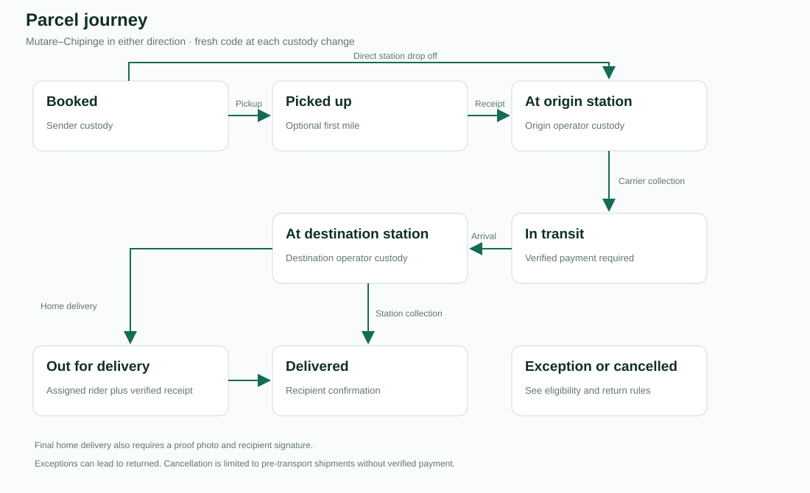
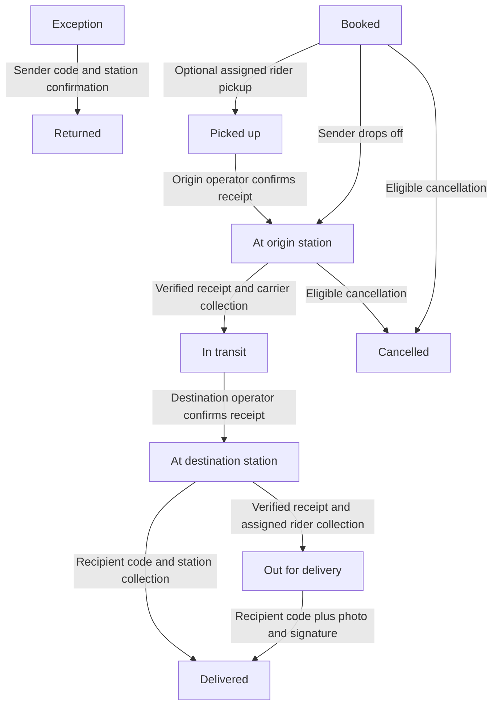
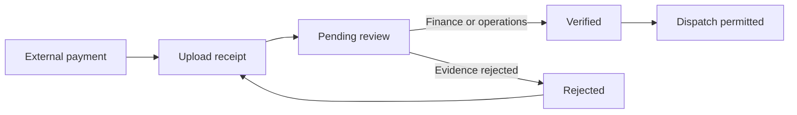
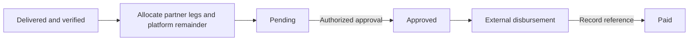
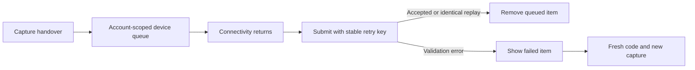

# Pano Logistics Workflows Document

Version 1.1 · 1 October 2026 · Mutare–Chipinge pilot

Update · 2 October 2026: [Operational completion](operational-completion.md) defines UC27–UC52, including the structured cancellation/return, refund, claim and exception workflows. Its return handover process supersedes direct legacy exception-to-return transitions described below.

## Purpose

This document explains the implemented end-to-end parcel journey and the account, payment, support and recovery processes around it. Operators can use it as a working reference; developers and testers can use the transition table and API references to verify behavior. It describes the current code, including limits, rather than treating proposal requirements as implemented features.

The browser routes are role-specific views over the same backend records. Django services validate mutations, maintain parcel projections and append custody events. Each custody event also queues replication to a separate archive. Money moves through external payment channels, and provider integration work is queued until a configured adapter processes it.

## Main shipment journey





Permitted non-closed parcels may be flagged as exception separately. The diagram omits those repeated arrows for readability. Payment submission and verification happen alongside custody and do not independently change parcel status.

## State and custody rules

| Current state | Requested state | Confirming receiving account | Code is issued to | Additional guards |
| --- | --- | --- | --- | --- |
| booked | picked_up | Assigned rider | Sender/current holder | Pickup address and accepted first-mile task |
| booked | at_origin_station | Origin station operator | Sender/current holder | Independent releasing and receiving accounts |
| picked_up | at_origin_station | Origin station operator | Current rider | Completes accepted first-mile task |
| at_origin_station | in_transit | Assigned carrier | Origin station operator/current holder | Verified payment and accepted transport task |
| in_transit | at_destination_station | Destination station operator | Carrier/current holder | Completes accepted transport task |
| at_destination_station | out_for_delivery | Assigned rider | Destination station operator/current holder | Home preference, verified payment and accepted last-mile task |
| at_destination_station | delivered | Destination station operator | Recipient | Station preference |
| out_for_delivery | delivered | Assigned rider | Recipient | Delivery photo and signature; completes last-mile task |
| exception | returned | Origin or destination station operator | Sender | Fresh return code |
| booked or at_origin_station | cancelled | Sender, operations or administrator | No code required | No verified payment; cancellation reason |
| Non-closed state | exception | Current holder or authorized station/operations staff | No code required | Issue note; no completed journey |

Codes are six digits, expire after fifteen minutes and belong to a specific next state. Five recorded attempts lock that issued code. Codes are hashed in Parcel.handover_otp and an active code cannot be regenerated to reset its attempt counter. A successful transfer clears it. A rejected attempt is appended as an alert event and does not advance the parcel. For ordinary network transfers the receiver must differ from the current custodian.

Booked parcels with a pickup address must complete picked_up before origin receipt; walk-in parcels go directly to origin receipt. Code issuance and custody validation enforce this distinction. At destination, both follow the selected station/home receiving preference.

## WF01 Account access

1. Credential users submit POST /api/auth/token/ and fetch GET /api/users/me/.
2. Phone users submit POST /api/auth/phone/request/ with name, +263 phone and public account role.
3. The server stores a hashed ten-minute challenge and queues an SMS delivery.
4. POST /api/auth/phone/verify/ checks expiry, attempt limit and prior use, then creates or resolves the account and returns tokens.
5. The workspace verifies the current profile and restricts navigation to the account role.

Existing staff must use credentials. Wrong or expired codes require another request. Local development may display a code with an explicit no-SMS warning. JWT refresh is available at POST /api/auth/token/refresh/; the active frontend does not yet automate refresh.

## WF02 Partner approval

1. A rider or carrier signs in with the corresponding role.
2. The partner supplies its station or vehicle details and an attachment through the application page.
3. POST /api/riders/ or /api/carriers/ creates the pending profile.
4. Operations reviews the privately served document.
5. POST /api/onboarding/{id}/approve/ or reject/ supplies the profile type and review reason.
6. Rejected applicants resubmit using PATCH on their own profile; status resets to pending.
7. Approved riders set availability with POST /api/riders/availability/.

Approval is a manual prerequisite for assignment. It does not create an assignment or a carrier departure.

## WF03 Booking and quoting

1. Choose active stations on the pilot pair, including the desired direction.
2. GET /api/rates/lookup/ resolves origin city, destination city and weight band.
3. The lookup prefers a tariff overridden for the origin station, otherwise the default city-pair rule.
4. Supply recipient details, parcel photo and any pickup address or handling instructions.
5. For a walk-in booking, authorized staff also supplies sender name and phone.
6. POST /api/parcels/ creates the priced shipment, sender relationship, booked_by relationship, initial custody projection and booking event.
7. The customer receives the shipment code and the recipient notification includes a secret tracking link.

Both UI and API require a valid parcel photo and supported weight band; Zimbabwe phone validation applies to recipient and station-booked sender details. Station staff can book only from their own origin station. Rates are illustrative seed values in USD and are not live market quotations.

## WF04 Trip scheduling and manual matching

1. An approved carrier or authorized staff creates a future route departure through POST /api/trips/.
2. Capacity must be positive and no greater than the vehicle capacity.
3. Operations selects a trip for a shipment through POST /api/matching/{parcel_id}/assign/.
4. The service checks exact route direction, active approval and remaining capacity.
5. Local riders must be approved, active, available and based in the appropriate origin or destination town.
6. The service creates offered tasks for selected workers and declines conflicting active offers for that leg.
7. Workers use POST /api/tasks/{id}/accept/ or decline/.

Capacity reservation uses the upper bound of each booked weight band. Delivered, returned and cancelled parcels are excluded from the current capacity calculation. An exception parcel still consumes capacity. Matching is manual; there is no automatic dispatch engine.

Task states are offered, accepted, declined and completed. Collection changes custody but leaves the task accepted until the receiving station or recipient confirms the leg's completion.

## WF05 Receipt submission and review



1. The sender, authorized staff or a worker with an accepted assignment makes or records payment outside the application.
2. POST /api/parcels/{code}/mark-paid/ submits method, transaction reference and receipt_photo as multipart data.
3. The server stores the parcel price as the payment amount and resets an unverified record to pending.
4. Finance, operations or administrator reviews evidence through POST /api/payments/{id}/verify/.
5. A verified record needs a receipt and matching parcel price, and cannot be replaced.
6. Carrier departure and home-delivery departure check for verified status.

A rejected receipt can be resubmitted. Verification does not itself dispatch a parcel, send money or change custody. No gateway, refund ledger or accounting reconciliation integration exists.

## WF06 Network custody

### First mile and origin receipt

For pickup, the rider accepts its first-mile assignment. POST /api/parcels/{code}/handover-code/ requests picked_up. The sender receives the code and shares it when the parcel changes hands. The rider sends to_status and otp through POST /api/tasks/{id}/complete/. For walk-in drop-off, the origin operator instead confirms at_origin_station through POST /api/parcels/{code}/handover/.

When a rider arrives at origin, the operator receives the rider's code and confirms at_origin_station. The server changes current_holder to the operator and completes the first-mile task.

### Carrier departure and destination receipt

The carrier accepts its inter-town task. It obtains the origin operator's code for in_transit and confirms collection through the task completion endpoint. The server verifies payment, receiving identity and task acceptance. The transport task remains accepted during transit.

On arrival, the destination operator obtains the carrier's code and confirms at_destination_station through the station handover endpoint. The service completes the carrier task and changes custody to the destination operator.

## WF07 Recipient choice and delivery

The sender can use POST /api/parcels/{code}/delivery-choice/. A guest recipient uses GET/POST /api/track/{token}/preferences/. The token is a credential for one shipment; keep it private. Home selection requires address details and becomes locked at home-delivery departure or a closed status.

### Station collection

1. Recipient opens the secret link at the station.
2. POST /api/track/{token}/code/ issues a delivery-specific receiving code.
3. Destination operator enters it for delivered.
4. The service checks station collection preference and operator identity.
5. Recipient confirmation is recorded, and network custody ends.

### Home delivery

1. Operations assigns an available destination-town rider.
2. Rider accepts its last-mile task.
3. Destination operator releases the parcel using a code for out_for_delivery.
4. Rider confirms collection; verified payment is checked again.
5. Recipient generates the final receiving code.
6. Rider records the code, a photo and a confirmed signature in the task handover form.
7. The service sets delivered, completes the task and retains private proof paths.

The application does not require a recipient account for either option. Ordinary parcel serializers omit handover codes; a code is returned only to the independent confirming party or through the authorized recipient link.

## WF08 Cancellation and exceptions

Eligible cancellation requires booked or origin-station status and no verified payment. POST /api/parcels/{code}/cancel/ appends a reasoned event, sets cancelled and declines offered/accepted tasks. Paid cancellation needs a support-assisted external process.

POST /api/parcels/{code}/exception/ records a problem and sets exception. The only implemented subsequent custody transition is returned. A station operator requests a fresh return code issued to the sender, then confirms return through the handover or exception-resolution endpoint. The current model does not distinguish attempted return, sender pickup and refund as separate states.

## WF09 Settlement and earnings



1. POST /api/payouts/run/ receives parcel database ID, period, first_mile_rider, last_mile_rider, carrier and station amounts. Unused rider legs receive zero.
2. The service rejects repeated runs, missing nonzero beneficiaries or allocations greater than price.
3. Platform amount is price minus the partner allocations.
4. Rider beneficiaries come from completed first-mile and last-mile tasks, not the overwritten current rider. Carrier beneficiary comes from the assigned carrier; station beneficiary is the origin operator.
5. POST /api/payouts/{id}/settle/ with action approve records approver and approval time.
6. After external payment, action disburse and a reference records paid status and time.
7. Partners read their own allocations through GET /api/earnings/ and retrieve individual HTML statements.
8. Authorized staff can download payment and payout CSV exports.

Allocations are not automatic transfers. Explicit-leg runs create five lines (two rider legs, carrier, origin station, platform), including zero-valued unused legs. Legacy rider requests create four lines and reject ambiguous two-rider allocations. FinanceEvent records allocation runs, approval, disbursement and receipt review.

## WF10 Support notifications and addresses

Support tickets store conversation messages in JSON with author and timestamp. Ticket creation records whether local time falls outside 08:00–20:00 and queues a helpdesk request. Support staff can set open, waiting_customer, resolved or closed; a closed conversation rejects replies. Helpdesk creation, replies and status changes are delivered through the adapter. Contacts outside 08:00–20:00 are scheduled for the next 08:00 opening; the worker skips them without consuming retries. /api/support-contact/ exposes the configured support phone and public portal URL, not provider secrets.

Booking, origin receipt, transit, destination receipt, delivery and exception generate notifications and SMS outbox entries. Notification.read_at tracks user acknowledgement. IntegrationDelivery tracks adapter processing and synchronizes linked Notification.status/sent_at. Development delivery stays development with no sent timestamp. Provider acceptance is not proof of delivery to the handset.

Saved addresses belong to the customer. Setting a default locks the user, clears prior defaults and applies the new default under a conditional uniqueness constraint.

## WF11 Offline capture and retry



The active task completion form can queue multipart data and files when navigator.onLine is false or a submission receives no server response due to a network failure. IndexedDB also stores fetched responses under account-scoped cache keys. Only work for the signed-in account is synchronized. Failed submissions stop the worker for investigation; retry or discard is available in the queue.

Task completion uses MutationReceipt with a unique user/key pair and a request fingerprint. Matching key and payload replays the original response; changed payload rejects reuse. A successful network submission is the confirmation point. The original network request and queued retry use the same idempotency key, so an accepted request with a lost response is not applied twice. Cached reads also recover on network failures; HTTP authorization/validation failures are not masked by cached data.

## WF12 Reporting administration and archive recovery

Reports expose:

- Volumes and delivered shipments from parcel records.
- Verified revenue from verified Payment amounts.
- Disbursements from paid Payout lines.
- First-attempt home delivery success from shipments dispatched for home delivery without an exception.
- Custody completeness from delivered journeys with the required accepted OTP transitions.
- Pre-dispatch verification from payment timestamps compared with the first dispatch event.
- The qualifying denominator for each quality measure.

After a StatusEvent insert, a signal creates an event_log outbox record. Run the worker from backend:

```powershell
python manage.py process_outbox --kind event_log
python manage.py rebuild_tracking
```

The first command replicates queued or failed archive entries. The second checks parcel status/holder projections without mutation. Only during a controlled maintenance window, after draining replication and backing up data, use rebuild_tracking --apply to repair projections. It does not rebuild payment, task or file records. Pending archive delivery prevents replay.

The worker also accepts --kind sms or --kind helpdesk. Entries with fewer than ten attempts are eligible for retries. Local console SMS is marked development and sends nothing externally; HTTPS webhook acceptance is marked sent, which is not an end-recipient delivery acknowledgement. Scheduling the command, selecting providers and configuring secrets remain deployment responsibilities.

## Operating limits and implementation references

The current implementation has no payment gateway, automatic matching, native mobile application, barcode scanning, automatic refund workflow or provider delivery callbacks. Seeded historical journeys may lack actual proof files and should not be used as evidence of completed real-world transfers.

Custody and settlement logic resides in workflows.py; booking, receipt and matching services reside in services.py. Views and serializers expose the validated API. The database reference documents the exact tables and relationships. See [Use cases](use-cases.md) and [Database reference](database.md).
